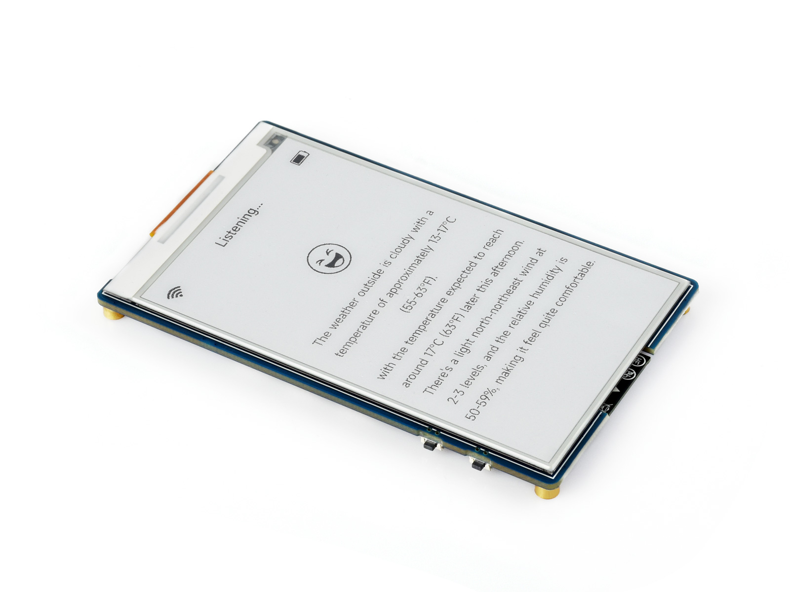

  <h1>ESP32-S3-ePaper-3.97</h1>
  
<a href="README_ZH.md">简体中文</a>

  

  
<a href="firmware/README.md">Firmware</a> · <a href="examples/esp-idf/">ESP-IDF</a> · <a href="examples/arduino/examples/">Arduino</a>

  

## ✨ Overview

An ESP32-S3 development board with a 3.97-inch e-paper display. This repository provides factory firmware and peripheral examples.

| Feature | Specification |
| --- | --- |
| MCU | ESP32-S3 |
| Memory | 16 MB Flash / 8 MB PSRAM |
| Display | 3.97″ ePaper |

## 📦 Quick Start

Follow the [factory firmware instructions](firmware/README.md) to download and flash the image.

## 🧪 Examples

| ESP-IDF | Function |
| --- | --- |
| [01_E-Paper_Example](examples/esp-idf/01_E-Paper_Example/README.md) | E-paper refresh |
| [02_Mic_test](examples/esp-idf/02_Mic_test/README.md) | Microphone input |
| [03_Music](examples/esp-idf/03_Music/README.md) | Music playback |
| [04_SD_Test](examples/esp-idf/04_SD_Test/README.md) | SD card access |
| [05_QMI8658A](examples/esp-idf/05_QMI8658A/README.md) | Motion sensor |
| [06_I2C_PCF85063](examples/esp-idf/06_I2C_PCF85063/README.md) | RTC |
| [07_I2C_SHTC3](examples/esp-idf/07_I2C_SHTC3/README.md) | Temperature and humidity |
| [08_ESP32-S3_e-Paper-3.97](examples/esp-idf/08_ESP32-S3_e-Paper-3.97/README.md) | Multi-function e-paper application |

| Arduino | Function |
| --- | --- |
| [01_Audio_Test](examples/arduino/examples/01_Audio_Test/README.md) | Audio playback |
| [02_E-Paper_Example](examples/arduino/examples/02_E-Paper_Example/README.md) | E-paper refresh |
| [03_I2C_PCF85063](examples/arduino/examples/03_I2C_PCF85063/README.md) | RTC |
| [04_I2C_SHTC3](examples/arduino/examples/04_I2C_SHTC3/README.md) | Temperature and humidity |
| [05_SD_Test](examples/arduino/examples/05_SD_Test/README.md) | SD card |
| [06_QMI8658A](examples/arduino/examples/06_QMI8658A/README.md) | Motion sensor |

## 🛠️ Development Environment

| Framework | Version | Examples |
| --- | --- | --- |
| ESP-IDF | v5.5 | 8 |
| Arduino ESP32 | 3.2.0 | 6 |

## 📚 Resources

- [Schematic](hardware/schematic/ESP32-S3-ePaper-3.97-Schematic.pdf)
- [Mechanical drawings](https://www.waveshare.net/w/upload/c/cc/ESP32-S3-EPAPER-3.97.zip)
- [Product page](https://www.waveshare.com/esp32-s3-epaper-3.97.htm)
- [Wiki](https://www.waveshare.com/wiki/ESP32-S3-ePaper-3.97)
