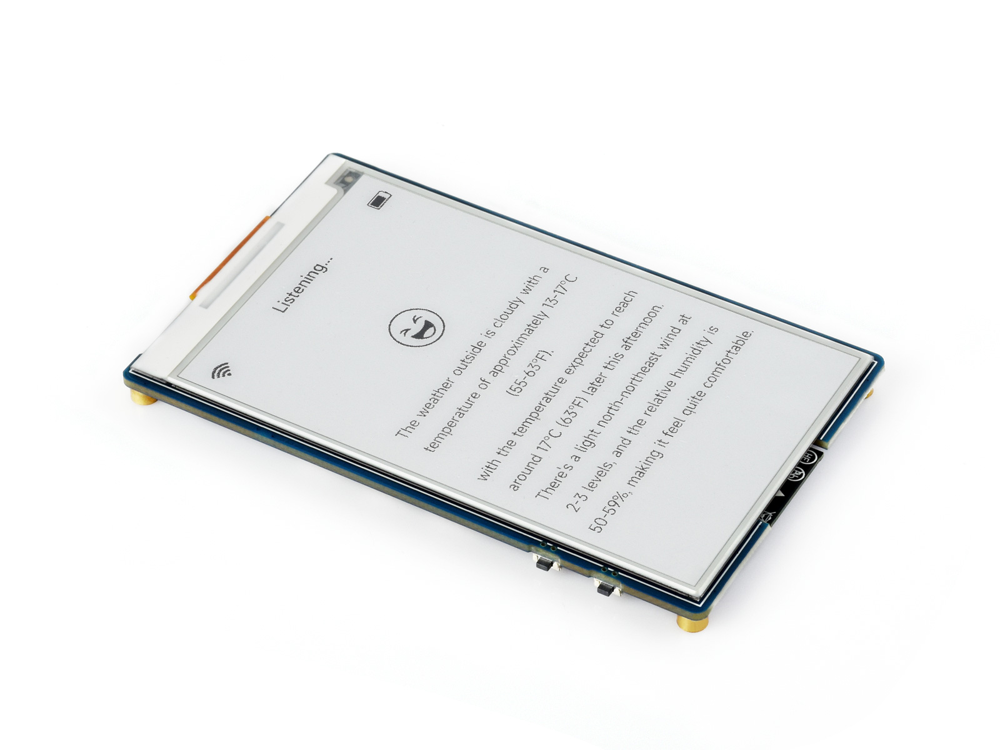

  <h1>ESP32-S3-ePaper-3.97</h1>
  
<a href="README.md">English</a>

  

  
<a href="firmware/README_ZH.md">固件</a> · <a href="examples/esp-idf/">ESP-IDF</a> · <a href="examples/arduino/examples/">Arduino</a>

  

## ✨ 概述

搭载 3.97 英寸墨水屏的 ESP32-S3 开发板。本仓库提供出厂固件及外设示例。

| 项目 | 规格 |
| --- | --- |
| MCU | ESP32-S3 |
| 存储 | 16 MB Flash / 8 MB PSRAM |
| 显示 | 3.97″ ePaper |

## 📦 快速开始

按[出厂固件说明](firmware/README_ZH.md)下载并烧录。

## 🧪 示例

| ESP-IDF | 功能 |
| --- | --- |
| [01_E-Paper_Example](examples/esp-idf/01_E-Paper_Example/README_ZH.md) | 墨水屏刷新 |
| [02_Mic_test](examples/esp-idf/02_Mic_test/README_ZH.md) | 麦克风输入 |
| [03_Music](examples/esp-idf/03_Music/README_ZH.md) | 音乐播放 |
| [04_SD_Test](examples/esp-idf/04_SD_Test/README_ZH.md) | SD 卡访问 |
| [05_QMI8658A](examples/esp-idf/05_QMI8658A/README_ZH.md) | 运动传感器 |
| [06_I2C_PCF85063](examples/esp-idf/06_I2C_PCF85063/README_ZH.md) | 实时时钟 |
| [07_I2C_SHTC3](examples/esp-idf/07_I2C_SHTC3/README_ZH.md) | 温湿度 |
| [08_ESP32-S3_e-Paper-3.97](examples/esp-idf/08_ESP32-S3_e-Paper-3.97/README_ZH.md) | 多功能墨水屏应用 |

| Arduino | 功能 |
| --- | --- |
| [01_Audio_Test](examples/arduino/examples/01_Audio_Test/README_ZH.md) | 音频播放 |
| [02_E-Paper_Example](examples/arduino/examples/02_E-Paper_Example/README_ZH.md) | 墨水屏刷新 |
| [03_I2C_PCF85063](examples/arduino/examples/03_I2C_PCF85063/README_ZH.md) | 实时时钟 |
| [04_I2C_SHTC3](examples/arduino/examples/04_I2C_SHTC3/README_ZH.md) | 温湿度 |
| [05_SD_Test](examples/arduino/examples/05_SD_Test/README_ZH.md) | SD 卡 |
| [06_QMI8658A](examples/arduino/examples/06_QMI8658A/README_ZH.md) | 运动传感器 |

## 🛠️ 开发环境

| 框架 | 版本 | 示例数 |
| --- | --- | --- |
| ESP-IDF | v5.5 | 8 |
| Arduino ESP32 | 3.2.0 | 6 |

## 📚 资料

- [原理图](hardware/schematic/ESP32-S3-ePaper-3.97-Schematic.pdf)
- [结构图](https://www.waveshare.net/w/upload/c/cc/ESP32-S3-EPAPER-3.97.zip)
- [产品页](https://www.waveshare.com/esp32-s3-epaper-3.97.htm)
- [Wiki](https://docs.waveshare.net/ESP32-S3-ePaper-3.97/)
